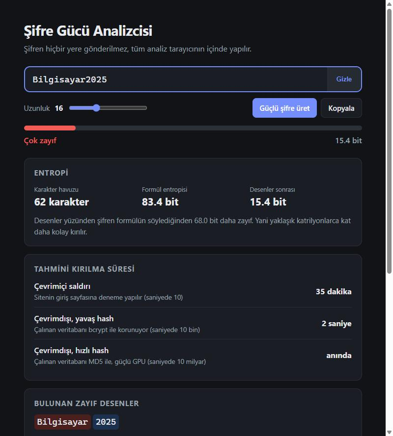

# Şifre Gücü Analizcisi

Bir şifrenin gerçekte ne kadar güçlü olduğunu analiz eden, tamamen tarayıcıda çalışan bir web aracı.

**🔗 Canlı demo:** https://ceylintacr.github.io/password-strength-analyzer/



## Neden?

Klasik şifre kontrolleri "büyük harf, rakam ve sembol var mı?" diye bakar. Ama bu kontroller yanıltıcıdır:

| Şifre | Formül entropisi | Gerçek entropi | Hızlı saldırıda kırılma |
|---|---|---|---|
| `Bilgisayar2025` | 83.4 bit | 15.4 bit | anında |
| `P@ssw0rd` | 52.6 bit | 3.6 bit | anında |
| `mavikedibahcedeuyur` | 89.3 bit | 77.8 bit | ~412 bin yıl |

`Bilgisayar2025` kâğıt üzerinde çok güçlü görünür, ama saldırgan onu harf harf değil, **"yaygın kelime + yıl"** olarak tahmin eder. Bu araç tam olarak bu farkı gösterir.

## Özellikler

- **Entropi hesabı:** `uzunluk × log2(karakter havuzu)`
- **Desen tespiti:** formülün göremediği zayıflıkları bulur ve gerçek entropiyi yeniden hesaplar:
  - Yaygın şifreler ve kelimeler (Türkçe olanlar dahil)
  - Leetspeak dönüşümleri (`P@ssw0rd` → `password`)
  - Klavye ve alfabe dizileri (`qwerty`, `12345`, `cba`)
  - Tekrarlar (`aaaa`, `abcabc`)
  - Yıllar (`1990`, `2024`)
- **Kırılma süresi tahmini:** 3 farklı saldırı senaryosu için (çevrimiçi, bcrypt, MD5 + GPU)
- **Kontrol listesi ve kişiselleştirilmiş öneriler**
- **Güçlü şifre üretici:** `crypto.getRandomValues` ile kriptografik olarak güvenli

## Nasıl çalışır?

1. **Karakter havuzu:** Şifrede hangi karakter türleri var? (küçük harf 26, büyük harf 26, rakam 10, sembol 33)
2. **Formül entropisi:** `uzunluk × log2(havuz)`. Şifrenin tamamen rastgele olduğunu varsayar.
3. **Desen analizi:** Şifre parçalara ayrılır. Tanıdık bir desene uyan parça, saldırganın onu bulmak için gereken deneme sayısı kadar değer alır (ör. listedeki 2. şifre ≈ 1.6 bit). Kalan karakterler normal değerini korur. Çakışan desenler arasından entropiyi en çok düşürenler seçilir.
4. **Kırılma süresi:** `2^bit / 2` tahmin (ortalama durum) ÷ saniyedeki tahmin sayısı

Bu yaklaşım, Dropbox'ın geliştirdiği [zxcvbn](https://github.com/dropbox/zxcvbn) kütüphanesinin basitleştirilmiş bir versiyonudur.

## Güvenlik tasarımı

- **Şifre hiçbir yere gönderilmez.** Ağ isteği yoktur, tüm analiz tarayıcıda yapılır.
- **XSS koruması:** Kullanıcı girdisi sayfaya `innerHTML` ile değil, `textContent` ile yazılır.
- **Güvenli rastgelelik:** Şifre üretici `Math.random()` yerine `crypto.getRandomValues()` kullanır ve modulo yanlılığını *rejection sampling* ile önler.
- Şifre gizliyken desen parçaları ekranda maskelenir.

## Çalıştırma

Kurulum gerekmez, `index.html` dosyasını tarayıcıda açman yeterli.

## Dosya yapısı

```
├── index.html     Sayfa yapısı
├── style.css      Görünüm (açık/koyu tema)
├── common.js      Yaygın şifre listesi
├── analyzer.js    Entropi, desen tespiti, kırılma süresi
├── generator.js   Güvenli şifre üretici
└── app.js         Arayüz mantığı
```

## Sınırlamalar

- Yaygın şifre listesi eğitim amaçlı küçük bir örnektir (~200 şifre). Gerçek saldırganlar milyonlarca satırlık listeler kullanır.
- Kırılma süreleri kaba tahminlerdir; gerçek süre donanıma ve hash algoritmasına göre değişir.
